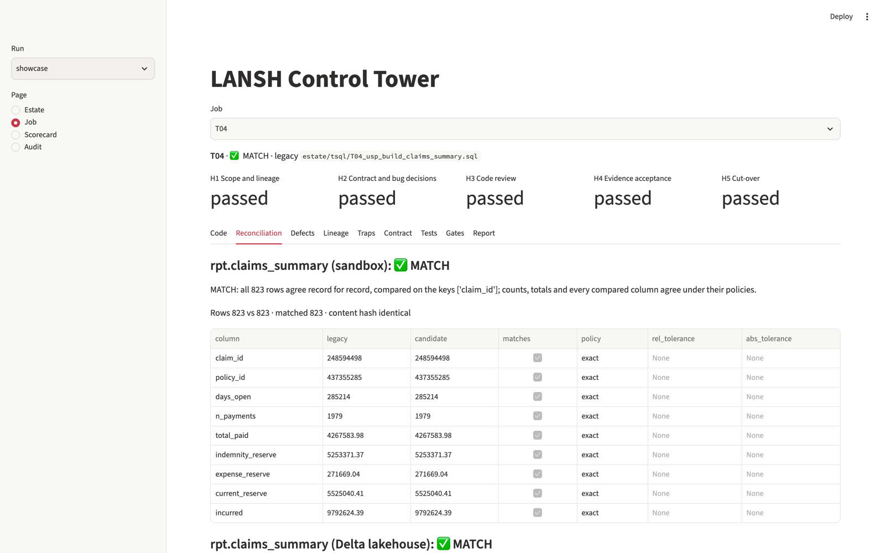

# LANSH

**EXL × Trinity Data & AI Hackathon 2026 · Challenge 03: Agentic data platform modernisation**

Team LANSH: Gregory Korchagin, Vansh Agarwal and Charly Martin Avila.

LANSH migrates legacy T-SQL and SAS jobs to PySpark on Delta, and proves each migration
before anyone signs it off. Every migrated job is reconciled against the output of the
original engine: schema, row counts, totals and every single record. Bugs in the legacy
code are not silently fixed. They are reproduced, measured and handed to a person to decide.

The short version: the proof travels with the migration.



## Submission

| Item | Link |
|---|---|
| Solution deck (EXL template) | [PowerPoint](docs/submission/LANSH_EXL_Submission.pptx) · [PDF](docs/submission/LANSH_EXL_Submission.pdf) |
| Architecture, one page | [PDF](docs/submission/LANSH_Architecture_B_Control_Room.pdf) · [Azure mapping](docs/architecture.md) |
| Responsible AI note, one page | [PDF](docs/submission/LANSH_Responsible_AI_B_Control_Room.pdf) |
| Demo video script | [docs/demo_video_script.md](docs/demo_video_script.md) |
| AI tools and existing code | [AI_USAGE.md](AI_USAGE.md) · [THIRD_PARTY.md](THIRD_PARTY.md) |
| All results, with sources | [runs/showcase/scorecard.md](runs/showcase/scorecard.md) |

## How it works

Each job goes through five stages, and each stage ends at a review gate.

| Stage | What happens | Gate |
|---|---|---|
| Discover | Parse the legacy code, map column-level lineage, flag risky language behaviour ("traps") | H1 Scope and lineage |
| Design | Write the data contract, measure each suspected legacy bug on the real output | H2 Contract and bug decisions |
| Generate | Translate to PySpark, generate trap-focused tests, reject unjustified hard-coded values | H3 Code review |
| Reconcile | Run the new job in isolation and compare it with the legacy output record for record | H4 Evidence acceptance |
| Operate | Re-run on Delta from migrated upstream outputs, reconcile again, check SLAs | H5 Cut-over |

Seven Claude agents do the language work: lineage, trap scan, contract, defect review,
translation, test writing, and diagnosis and repair. None of them has tools, every answer
is schema-checked, and every answer must pass a deterministic check before it is used.
If reconciliation fails, the repair loop diagnoses the difference, patches the code and
reconciles again. If it still fails, the job is escalated to a person.

Every gate decision is written to a hash-chained log (`runs/<run>/gates.jsonl`), so any
later edit to the record is detectable with `lansh audit verify`.

## Run it

You need **Java 21** and **[uv](https://docs.astral.sh/uv/)**. On macOS:

```bash
brew install openjdk@21 uv
```

Then, from the repository root:

```bash
make setup        # installs Python 3.14 and the pinned dependencies
make demo         # replays T04 through all five stages, then opens the Control Tower
```

`make demo` takes about 75 seconds before the UI opens at <http://localhost:8501>. It
runs offline from recorded model answers: no Claude login, SQL Server or SAS account is
needed. The first Spark run may download the Delta JARs. If Java 21 is not in a standard
location, set `LANSH_JAVA_HOME`.

For the guided walkthrough used in the demo video:

```bash
LANSH_DEMO_RUNS=1 uv run lansh ui
```

The **Demo** page opens first and walks through six screens, including a button that
replays T04 through the real pipeline. The **Estate**, **Job**, **Scorecard** and
**Audit** pages hold the full evidence for every job.

## Results

All from the published run in [runs/showcase/](runs/showcase/). Every figure in the
[scorecard](runs/showcase/scorecard.md) names the files it was computed from and pins
them by SHA-256.

| Check | Result |
|---|---|
| Development estate (7 T-SQL, 3 SAS jobs) | 10 of 10 matched record for record on the first translation; 165,412 legacy rows proved |
| Planted legacy bugs | 8 of 8 reproduced exactly; 6 of 8 flagged with the planted diagnosis |
| Labelled trap occurrences | 81 of 82 detected |
| Comparison: sqlglot alone | 0 of 10 matched |
| Comparison: one-shot Claude, same model | 8 of 10 matched; the other two ran without error but got 805 rows wrong |
| Comparison: one-shot Claude plus LANSH's repair loop | 10 of 10 matched |
| Sealed held-out jobs, first run | 1 of 2 matched; the other was stopped by a failing test and escalated |
| Held-out jobs after the learning fixes | 2 of 2 matched (a second run, not a held-out result) |
| Manual baseline, by hand with AI switched off | 148 minutes (T05) and 169 minutes (S01); mean 2.6 hours per job |
| Machine time per job, every Claude call live | 5.35 minutes; about US$1.01 of model use |

The business case projects these numbers onto the client's 1,600 jobs. The manual
baseline is measured; escalation rate, review time and day rate are labelled assumptions.
At 30% escalation and 30 minutes of review per job, the projection is about half the
person-hours of a manual migration.

## Human review

Every gate needs a recorded decision, and the log records who made it. In our development
runs the factory's own agent approved the gates, and the logs record those approvals as
the agent's.
All three of us then reviewed and accepted the recorded decisions after the runs, with
Gregory and Vansh doing most of the review. Each published run has a `human_review.json`
that lists the decisions covered and pins the original gate log by hash; the original
logs are unchanged. Details are in [docs/human_reviews.md](docs/human_reviews.md) and
[docs/gates.md](docs/gates.md).

To run a job with a person at every gate:

```bash
uv run lansh run-job T04 --run review --mode replay --reviewer person:<your-name> --interactive
```

## Check it yourself

```bash
make check                                        # lint and the offline test suite
make test-e2e                                     # T04 end to end through all five gates
uv run lansh audit verify --run showcase          # gate log intact
uv run lansh audit verify --run showcase/held-out
uv run lansh audit verify --run showcase/learning
uv run lansh freeze                               # factory matches its recorded freeze
```

## Repository layout

| Path | Contents |
|---|---|
| `src/lansh/` | The factory, CLI and Control Tower |
| `estate/` | Synthetic insurer data, the legacy T-SQL and SAS jobs, their captured outputs, the answer key and the sealed held-out jobs |
| `migrated/` | Generated PySpark jobs, contracts and tests |
| `runs/showcase/` | Published evidence, comparison runs, review records and the scorecard |
| `runs/cassettes/` | Recorded model and legacy-engine answers for offline replay |
| `runs/freeze.json` | Hashes of the frozen factory |
| `baseline/` | Timesheet for the manual migrations |
| `tests/`, `spikes/` | Tests and the engine feasibility checks they use |
| `docs/` | Submission pack, architecture, review records and demo script |

Audit entries keep the paths of the runs they were recorded in: `runs/dev-estate/` is
published as `runs/showcase/`, `dev-holdout` as `showcase/held-out` and
`dev-holdout-learn` as `showcase/learning`.

## Live runs and legacy engines (optional)

Replay is the default. For live model calls, install and sign in to the Claude Code CLI
and add `--mode live`; LANSH calls Claude through `claude -p` on a subscription, so no
API key is needed.

To recapture the SQL Server outputs, set `MSSQL_SA_PASSWORD` in `.env`, start a Docker
runtime, then run `make legacy-up`, `make load` and `make legacy-verify`. SAS capture
also needs a SAS OnDemand account and a local saspy configuration
([spikes/README.md](spikes/README.md)). None of this is needed for the demo or the tests.

## Scope, data and limitations

- All data is synthetic (seed `20251231`), with fictional names and `.example` email
  addresses. No personal or client data is used.
- We wrote the legacy estate ourselves, with AI assistance, including its deliberate bugs.
  That is why two jobs were sealed and only run once, after the factory was frozen.
- Results cover one reporting date, 31 December 2025. Both held-out jobs are T-SQL, and
  SAS trap tests check the contract.
- Reconciliation catches wrong code, not missing requirements.
- The worker that runs migrated jobs does not enforce network isolation.
- The S04 risk model rates under-25s HIGH more often (14.3% against 5.3% for ages 25–59).
  LANSH reproduces it faithfully and flags it; whether that loading is justified is a
  business and legal decision.

See the Responsible AI note for the full list of safeguards and limitations.
