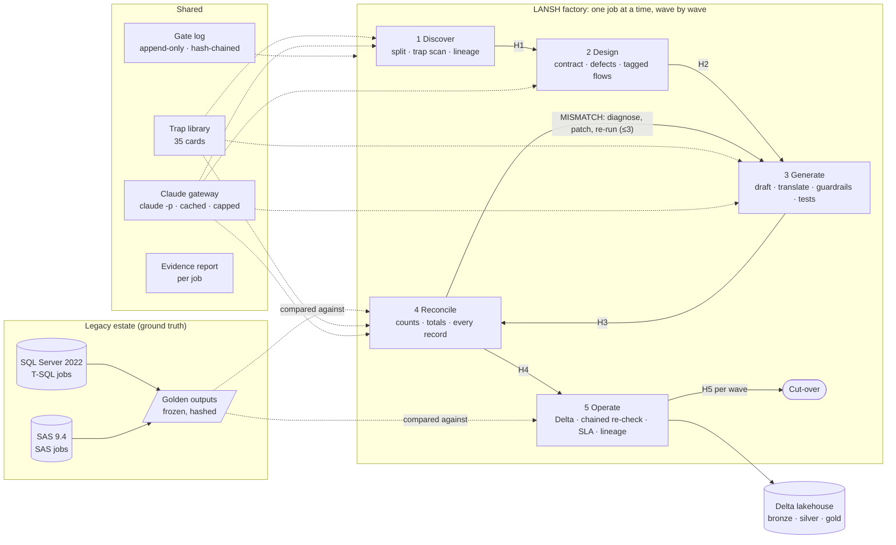

# LANSH architecture

**LANSH is a reconciliation-first migration factory.** It migrates legacy T-SQL and SAS jobs to
PySpark on Delta, and it accepts a job only once the job's new output matches the legacy
output record for record, bugs included. Agents propose, deterministic checks verify, and a
person approves at each of the five stages.

## The proof loop

| Stage | Agents (Claude Opus 5.5) | What checks them deterministically | Gate refuses approval while |
|---|---|---|---|
| **Discover** | Lineage; trap scan | Every column named must exist in the schemas; sqlglot traces the same lineage through temp tables; trap ids and lines are checked against the file | there is no verified lineage |
| **Design** | Contract; defect reviewer | Keys must be unique in the golden output; a tolerance needs an engine-level reason; each defect's impact query runs on golden data | a tolerance has no reason, or a defect or a flow of a protected column has no decision |
| **Generate** | Translator; test author | Guardrails (allowlisted imports, no I/O, SQL strings parsed, the **literal check**); the legacy engine computes every test's expected values | a guardrail fails, a literal is unexplained, or a test fails |
| **Reconcile** | Diagnoser/fixer | Schema, counts, totals, a full outer join on the keys, every column under its policy; diff signatures name the trap | the status isn't MATCH |
| **Operate** | — | The job runs on Delta with its upstream jobs' migrated outputs as inputs, and every output is reconciled again; SLA checks | a Delta output differs, or an SLA is broken |

- **Ground truth comes from the real engines:** outputs captured from SQL Server 2022 and SAS, frozen and hashed. No LLM decides what "correct" means.
- **Bugs are reproduced, never silently fixed:** marked `# LANSH-DEFECT`, their impact measured, and a person decides: *reproduce*, or *fix after cut-over*.
- **No silent tolerances:** comparison is exact by default; any other policy needs an engine-level reason and H2 approval.
- **One path to Claude** (`lansh.llm`): `claude -p` on a subscription, schema-checked answers, every answer recorded and replayable, at most 150 live calls a run.

## Azure target state

The prototype runs on one laptop, and the migrated code uses only APIs that Databricks
supports: no RDDs, no `.cache()`, no I/O inside a job.

| Concern | Prototype | Azure target state |
|---|---|---|
| Storage | Delta Lake on local disk, in bronze, silver and gold | ADLS Gen2 with Delta; Unity Catalog schemas for bronze, silver and gold |
| Compute | Local PySpark 4.2, one worker process per job | Azure Databricks jobs (serverless or job clusters) |
| Scheduling | One schedule file per wave (`runs/<run>/schedules/wave-N.yaml`, already in Databricks Workflows shape) | Databricks Workflows: one job per wave, one task per migrated job |
| Lineage | OpenLineage run events with column lineage | Unity Catalog lineage, or Microsoft Purview through OpenLineage |
| Agents | The Claude Code CLI on a subscription, with synthetic data only | Claude in Microsoft Foundry, inside the client's Azure tenancy and under enterprise terms |
| Gate sign-off | Local hash-chained gate log | Entra ID identities; approvals in the client's workflow tool |
| Secrets | `.env` and `~/.authinfo` | Azure Key Vault |
| Legacy side | SQL Server container and SAS OnDemand | The client's SQL Server and SAS, read by the parallel runs |
